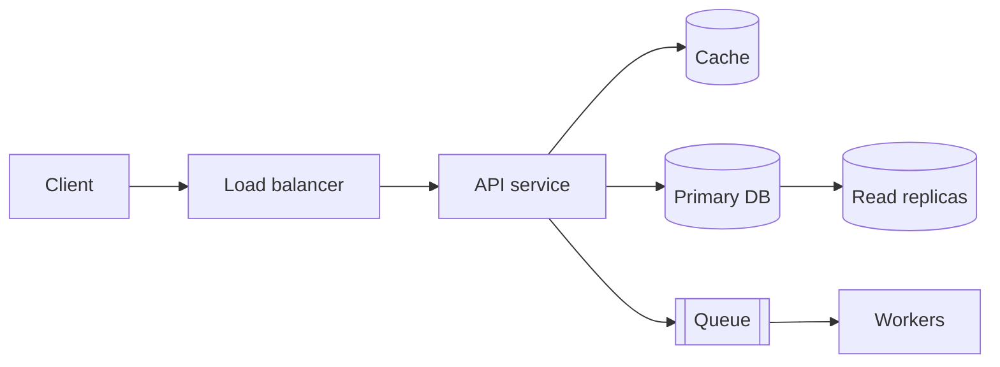

# Design

One markdown file per design, with a Mermaid diagram (the interview uses CoderPad + Mermaid, and its AI can't read Excalidraw). System designs go in `system/`, in-domain prompts in `in-domain/`. Time-box each and note what you'd cut or deepen.

## System design

| # | Date | Prompt | Time | Done |
| --- | --- | --- | --- | --- |
| 1 | Sat Nov 7 | Rate limiter | 60 min | [ ] |
| 2 | Sat Nov 7 | URL shortener | 60 min | [ ] |
| 3 | Sun Nov 8 | News feed | 60 min | [ ] |
| 4 | Tue Nov 10 | Messenger / chat | 60 min | [ ] |
| 5 | Wed Nov 11 | Distributed KV store | 60 min | [ ] |
| 6 | Sun Nov 15 | Distributed job scheduler | 45 min | [ ] |
| 7 | Mon Nov 16 | Top-K / trending | 45 min | [ ] |
| 8 | Tue Nov 17 | Metrics and monitoring system | 45 min | [ ] |
| 9 | Wed Nov 18 | Notification system | 45 min | [ ] |

## In-domain design

| # | Date | Prompt | Done |
| --- | --- | --- | --- |
| 1 | Sat Nov 7 | BGP telemetry pipeline | [ ] |
| 2 | Thu Nov 12 | Fabric for a 32K-GPU training cluster (read Meta's RoCE post and skim the SIGCOMM 2024 paper first) | [ ] |
| 3 | Sat Nov 14 | Edge egress traffic engineering (read Edge Fabric first) | [ ] |
| 4 | Sun Nov 15 | RIB/FIB pipeline for 10M routes on multi-core, 45 min | [ ] |
| 5 | Wed Nov 18 | Safe config rollout to 50K devices | [ ] |

## 45-minute framework

| Minutes | Step |
| --- | --- |
| 0–5 | Requirements: functional, non-functional, what's out of scope |
| 5–10 | Scale estimates and the API |
| 10–20 | High-level diagram in Mermaid; walk one request end to end |
| 20–35 | Deep dives: data model, the hardest component, bottleneck |
| 35–42 | Failure modes, tradeoffs, alternatives you rejected and why |
| 42–45 | Recap and what you'd do next |

## Mermaid starter

